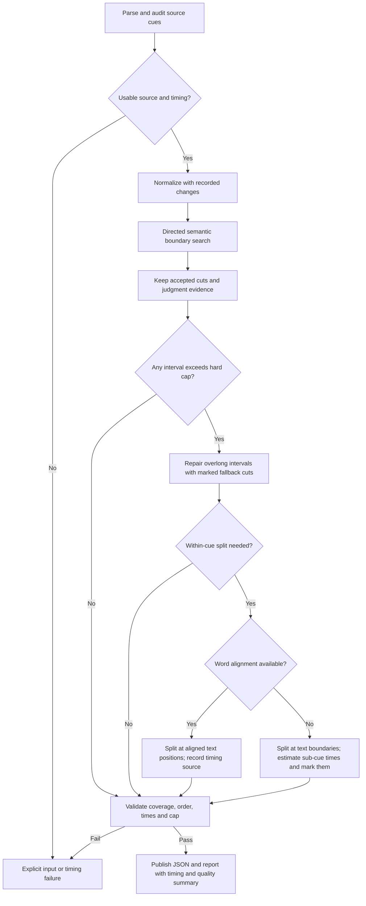
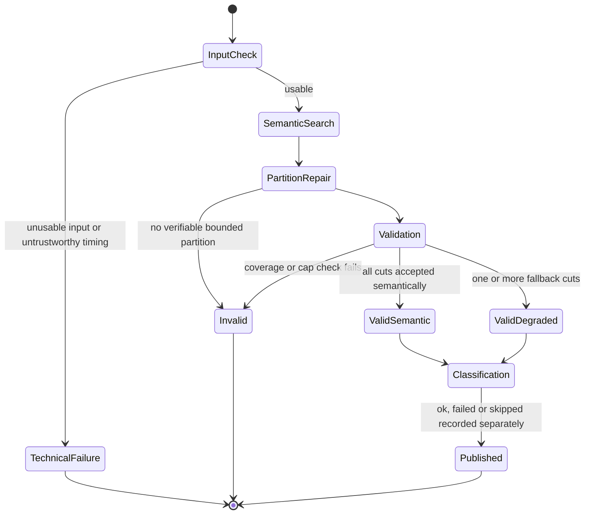

# SNU failsafe: a valid partition is not a good semantic cut

**Status: proposal for review, not implemented.** This document specifies a possible opt-in successor to the directed boundary search merged in PR #1. The current `jevclip snu` behavior, CLI options, output schema and exit codes remain unchanged by this document. In particular, `--force-max-snu` is **not** the failsafe described here: it cuts only at cue boundaries and may leave an oversized cue.

## Why this exists

The directed search should accept only boundaries that pass its semantic checks. On real transcripts it can run out of search budget, receive judge errors, or find no defensible cut before an SNU becomes too long. Lowering the semantic threshold to make a partition would misrepresent the cut's quality. Conversely, treating a complete but clearly labelled mechanical partition as a failed partition confuses *validity* with *quality*.

The proposed contract is: for a usable transcript, return ordered, nonempty SNUs covering the **normalized input cues** exactly once. A cap can be verified against cue timestamps at cue-level cuts; if a cut must fall inside a cue, its position in media time is only an estimate unless word-level alignment exists. In the proposed opt-in best-effort mode, validate the cap against the **output's estimated timestamps**, with a configurable planning margin, and mark every estimated within-cue cut and affected unit. Do not claim this verifies actual spoken duration: a 10–15% timing error is acceptable for this use case, but is not a measured guarantee. Fallback boundaries are never silently promoted to semantic judgments. Untimed text needs a separate text/estimated-time policy, not a video-time claim.

## Proposed flow

The diagram describes the proposed **opt-in best-effort mode**. `Pass` means exact normalized-text coverage and a validated cap on the output timestamps, including explicitly estimated timestamps; it does **not** certify a measured video-time bound. A future strict measured-time mode could instead fail at `H` when alignment is missing.

### 1. Preserve semantic decisions

Run today's directed search first. A cut is `accepted_semantic` only if it passed the existing relation, score, confidence, completeness, and direction checks. Preserve rejected and errored verdicts and the budget-exhaustion reasons; do not reinterpret them as accepted judgments. The search can be incomplete even when the eventual partition is valid.

### 2. Repair only overlong intervals

Walk the spans between accepted cuts (including the start and end of the transcript). For each span that would cross the cap, find a feasible cut between the current start and the first cue that would make the current SNU exceed the cap. Among feasible candidates, use a deterministic preference order:

1. Already judged but rejected cue boundary with the strongest available evidence (still `best_effort_judged`, not accepted).
2. Pause or sentence-ending cue boundary (`best_effort_pause` / `best_effort_sentence`).
3. Latest feasible cue boundary (`best_effort_cue`).

Within a tier, document the score and tie-break order in implementation; do not make a new Jev call just to hide a missing judgment. A chosen boundary must leave the previous unit within the cap and must advance the source position. If the next cue alone exceeds the cap, cue-level cuts cannot solve it. If every available cut strands a short tail, prefer the hard cap and record the short tail as a quality warning; the minimum-duration target is soft, never a reason to violate a hard maximum. Re-check all resulting spans: a locally attractive boundary is not proof that the suffix is feasible.

### 3. The overlong-cue limit

An individually overlong cue needs more than a cue-boundary cut. Prefer reliable word alignment to media time if available. Otherwise, in this opt-in mode, split its normalized text at sentence boundaries, then word boundaries, then grapheme boundaries only if necessary; retain contiguous source offsets. Assign sub-cue times by a deterministic, documented text-length interpolation within the original cue's start/end interval. Preserve the original cue endpoints and use shared estimated cut times for adjacent pieces so no interval or text is lost or duplicated. Record `timing_basis: interpolated_cue` on affected units/cuts; aligned cuts must record their actual alignment source. **Plain SRT/VTT cue start/end times do not locate words inside a cue.** Interpolation is an approximation, not a certification of actual spoken/video duration.

Aim below the requested cap to allow for timing error. For example, with a 90-second desired limit and a 15% planning margin, target roughly 78 seconds of estimated duration; validate every resulting output duration against the configured cap as well. The margin does not make a 90-second measured-duration guarantee, and no fixed percentage can bound arbitrary pauses or uneven speech inside a cue. If even a grapheme-level split cannot produce nonempty, advancing units under the configured estimated cap, fail explicitly rather than publish an invalid partition.

Timestamp gaps count towards an SNU's elapsed `end - start` duration. Audit the raw parsed cues **before** normalization: today's `_clean()` silently drops reversed cues and does not reject nonfinite times. Reject nonfinite, reversed, or overlapping cue timings that cannot be represented as ordered, non-overlapping units without losing text; do not silently rewrite them to pass validation. If normalization drops duplicate rolling captions or markup, coverage is defined against the resulting normalized cue/text stream, with the normalization policy reported separately. Start-only copied transcripts currently synthesize end times from reading rate but mark them as timed; persist their inferred timing basis and never label those bounds measured. Preserve enough timestamp precision through storage to validate the same values that are serialized; millisecond rounding must not silently push a cut over the cap.

### 4. Validate before publication

Represent each output as half-open source ranges, e.g. `(cue_index, text_start, text_stop)`, so within-cue pieces can be checked without comparing re-formatted strings. Validation checks:

- At least one nonempty unit; source ranges are contiguous, ordered, disjoint, and cover every normalized cue's text exactly once (no loss or duplication).
- Every unit has finite, ordered start/end times; units follow source order and have non-overlapping time intervals. Gaps between units are allowed.
- Every unit has `end - start <= max_snu_seconds` **according to its output timestamps**, with a specified tolerance for rounding; validate before and after serialization. An interpolated or otherwise inferred interval must not be described as a measured bound.
- Every cut has its provenance, reason, available judgment evidence and timing basis; retain estimated timing provenance in JSON and report.

Build and validate in memory, then publish a single coherent result and report. On validation failure, return a nonzero status and diagnostic; do not leave a newly generated `snus.json` that looks valid. Existing outputs from earlier runs must not be mistaken for this run's result (remove, replace atomically, or segregate by run). Classification and rendering happen only after the partition contract is checked, and file publication needs a failure-safe strategy for both artifacts.

## Outcome is multidimensional

Proposed result fields (names illustrative until implementation review):

| Dimension | Values / evidence | Meaning |
|---|---|---|
| Partition | `valid` / `invalid`; coverage and output-timestamp cap checks, timing basis | Mathematical completeness and bounded output duration, **not** guaranteed actual spoken duration or semantic quality |
| Cut | `accepted_semantic`, `best_effort_judged`, `best_effort_pause`, `best_effort_sentence`, `best_effort_cue`, `best_effort_within_cue` | Per-boundary provenance, reason, score if available, timing basis; never upgrade a fallback to accepted |
| Quality | fallback cut count, affected unit count and duration share, short tails, unresolved search reasons | A valid partition may still be low quality |
| Classification | `ok` / `failed` / `skipped` per SNU | Kind/standalone labeling is independent of partition validity |

Do not reuse today's overloaded `SNU.status` as the sole indicator: it currently mixes `unresolved`, `oversized_unresolved`, `forced_low_quality`, and classification `error`. Preserve legacy output semantics for existing callers or version the schema and document migration. A classification error must remain visible and must not turn an otherwise valid partition into an invalid one; whether a caller requires classification is its own policy decision.

## CLI and downstream contract

Introduce a distinct opt-in best-effort mode, tentatively `--ensure-partition --max-snu-seconds N` (finite `N > 0`), rather than changing the meaning of existing `--max-snu-seconds` or `--force-max-snu`. Define the configurable planning margin separately (tentatively `--timing-margin 0.15`, only relevant for estimated cuts); do not silently loosen `N`. Default strict semantic search remains unchanged. The intended opt-in exit contract is **0** for a validated partition bounded by its **output timestamps**, including one explicitly marked degraded by fallback cuts or estimated timing; **nonzero** for unusable input, no bounded output partition, validation/publication failure, or other technical failure. Judge unavailability can produce a fully marked fallback partition only under an explicit policy, not as an unannounced semantic success. Batch exit is nonzero if any input fails. Callers that require measured timing, semantic quality or classification can reject a valid-but-degraded output based on separate metadata.

Downstream ingestion should consume only the versioned, validated partition and retain cut provenance, timing basis and quality metrics; it should not infer success from the existence of `snus.json` or from SNU count alone. Do not change downstream ingestion policy until the jevclip contract is implemented, tested, and reviewed. This document does **not** introduce or endorse a silent always-succeed mode or a measured-time guarantee for interpolated cuts.

## Implementation order and acceptance checks

1. Audit raw cue timings before normalization; record normalization changes. Define and test source-range and timing-basis representations, including inferred ends for start-only transcripts; decide schema versioning and migration for existing JSON consumers.
2. Implement deterministic fallback selection and within-cue alignment or text-based interpolation with a planning margin, without altering existing mode.
3. Add coverage/time/output-cap validator and failure-safe publication; separate classification status from partition/quality.
4. Expose opt-in CLI and document exit codes, then integrate downstream only after contract tests pass.

Tests should cover no accepted boundaries; partial semantic cuts; exhausted budget and judge errors (including explicit judge-unavailable policy); rejected high-scoring candidate provenance; a single overlong cue with/without reliable alignment and with unevenly spaced text; an impossible estimated cap; short tails; timestamp gaps, overlaps, reversed and nonfinite times before normalization; untimed scripts and start-only transcripts with inferred ends; exact normalized-text coverage/order across within-cue splits; classification failure; rounding at the cap; stale output after failure; multi-input exit behavior. Re-run the real transcripts that yielded oversized unresolved SNUs and inspect output-timestamp cap, fallback rate and actual timing error against media on a small labelled sample; do not infer a 10–15% error rate from interpolation alone.

**Review questions before coding:** Which downstream consumers rely on today's `status` and exit codes? What deterministic tie-break and fallback-quality thresholds should ingestion apply? Should aligned and interpolated timing share the opt-in schema with per-unit timing basis, or need separate consumer policies? How much error does interpolation show on representative long cues?
