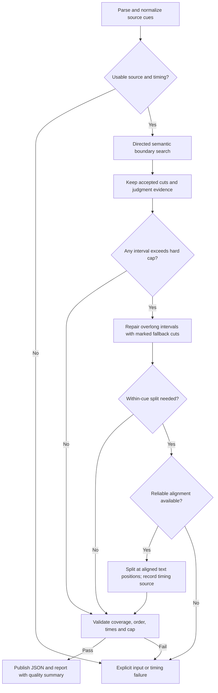
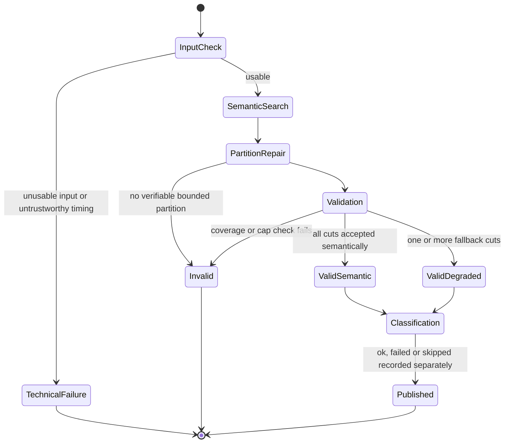

# SNU failsafe: a valid partition is not a good semantic cut

**Status: proposal for review, not implemented.** This document specifies a possible opt-in successor to the directed boundary search merged in PR #1. The current `jevclip snu` behavior, CLI options, output schema and exit codes remain unchanged by this document. In particular, `--force-max-snu` is **not** the failsafe described here: it cuts only at cue boundaries and may leave an oversized cue.

## Why this exists

The directed search should accept only boundaries that pass its semantic checks. On real transcripts it can run out of search budget, receive judge errors, or find no defensible cut before an SNU becomes too long. Lowering the semantic threshold to make a partition would misrepresent the cut's quality. Conversely, treating a complete but clearly labelled mechanical partition as a failed partition confuses *validity* with *quality*.

The proposed contract is: for a usable, timed transcript, return ordered, nonempty SNUs covering the **normalized input cues** exactly once, with each output duration at most a configured hard cap, **only if that guarantee can actually be verified**. If it cannot, fail explicitly; do not publish the proposed validated result. Fallback boundaries are visibly best-effort, never silently promoted to semantic judgments. For untimed text, offer at most a separate, explicitly labelled text/estimated-time policy; an estimated reading duration is not a video-time guarantee.

## Proposed flow

The diagram describes the **strict measured-time mode**. An optional estimated-time mode, if built later, has a different output guarantee and must never take the `Pass` path claiming measured video-time bounds.

### 1. Preserve semantic decisions

Run today's directed search first. A cut is `accepted_semantic` only if it passed the existing relation, score, confidence, completeness, and direction checks. Preserve rejected and errored verdicts and the budget-exhaustion reasons; do not reinterpret them as accepted judgments. The search can be incomplete even when the eventual partition is valid.

### 2. Repair only overlong intervals

Walk the spans between accepted cuts (including the start and end of the transcript). For each span that would cross the cap, find a feasible cut between the current start and the first cue that would make the current SNU exceed the cap. Among feasible candidates, use a deterministic preference order:

1. Already judged but rejected cue boundary with the strongest available evidence (still `best_effort_judged`, not accepted).
2. Pause or sentence-ending cue boundary (`best_effort_pause` / `best_effort_sentence`).
3. Latest feasible cue boundary (`best_effort_cue`).

Within a tier, document the score and tie-break order in implementation; do not make a new Jev call just to hide a missing judgment. A chosen boundary must leave the previous unit within the cap and must advance the source position. If the next cue alone exceeds the cap, cue-level cuts cannot solve it. If every available cut strands a short tail, prefer the hard cap and record the short tail as a quality warning; the minimum-duration target is soft, never a reason to violate a hard maximum. Re-check all resulting spans: a locally attractive boundary is not proof that the suffix is feasible.

### 3. The overlong-cue limit

An individually overlong cue needs more than a cue-boundary cut. If reliable word/character alignment to media time exists, split at text positions and retain exact source offsets plus the alignment source; prefer word boundaries, then grapheme boundaries where necessary. **Plain SRT/VTT cue start/end times do not locate words inside a cue.** Interpolating sub-cue times by text length can produce an *estimated* partition but cannot certify a hard bound on actual spoken/video content. In strict measured-time mode, an overlong cue without reliable alignment is an explicit failure, not a success with invented measured timestamps. A future opt-in estimate mode may expose `timing_basis: estimated` and a separately named estimated cap, without promising a measured video-time cap.

Timestamp gaps count towards an SNU's elapsed `end - start` duration. Reject nonfinite, reversed, or overlapping cue timings that cannot be represented as ordered, non-overlapping units without losing or inventing alignment; do not silently rewrite them to pass validation. If normalization drops duplicate rolling captions or markup, coverage is defined against the resulting normalized cue/text stream, with the normalization policy reported separately.

### 4. Validate before publication

Represent each output as half-open source ranges, e.g. `(cue_index, text_start, text_stop)`, so within-cue pieces can be checked without comparing re-formatted strings. Validation checks:

- At least one nonempty unit; source ranges are contiguous, ordered, disjoint, and cover every normalized cue's text exactly once (no loss or duplication).
- Every unit has finite, ordered start/end times; units follow source order and have non-overlapping time intervals in strict mode. Gaps between units are allowed.
- Every strict timed unit has `end - start <= max_snu_seconds`, with a specified tolerance for rounding; validate unrounded values before serializing timestamps.
- Every cut has its provenance, reason and available judgment evidence; estimated timings cannot be serialized as measured timings.

Build and validate in memory, then publish a single coherent result and report. On validation failure, return a nonzero status and diagnostic; do not leave a newly generated `snus.json` that looks valid. Existing outputs from earlier runs must not be mistaken for this run's result (remove, replace atomically, or segregate by run). Classification and rendering happen only after the partition contract is checked, and file publication needs a failure-safe strategy for both artifacts.

## Outcome is multidimensional

Proposed result fields (names illustrative until implementation review):

| Dimension | Values / evidence | Meaning |
|---|---|---|
| Partition | `valid` / `invalid`; coverage and cap checks, timing basis | Mathematical completeness and bounded duration, not semantic quality |
| Cut | `accepted_semantic`, `best_effort_judged`, `best_effort_pause`, `best_effort_sentence`, `best_effort_cue`, `best_effort_within_cue` | Per-boundary provenance, reason, score if available; never upgrade a fallback to accepted |
| Quality | fallback cut count, affected unit count and duration share, short tails, unresolved search reasons | A valid partition may still be low quality |
| Classification | `ok` / `failed` / `skipped` per SNU | Kind/standalone labeling is independent of partition validity |

Do not reuse today's overloaded `SNU.status` as the sole indicator: it currently mixes `unresolved`, `oversized_unresolved`, `forced_low_quality`, and classification `error`. Preserve legacy output semantics for existing callers or version the schema and document migration. A classification error must remain visible and must not turn an otherwise valid partition into an invalid one; whether a caller requires classification is its own policy decision.

## CLI and downstream contract

Introduce a distinct opt-in mode, tentatively `--ensure-partition --max-snu-seconds N` (finite `N > 0`), rather than changing the meaning of existing `--max-snu-seconds` or `--force-max-snu`. Default strict search remains unchanged. The intended strict-mode exit contract is **0** for a validated measured-time partition, including one explicitly marked degraded by fallback cuts; **nonzero** for unusable input, unverifiable timing, no bounded partition, validation/publication failure, or other technical failure. Judge unavailability can produce a fully marked fallback partition only under an explicit policy, not as an unannounced semantic success. Batch exit is nonzero if any input fails. Callers that require semantic quality or classification can reject a valid-but-degraded output based on its separate metadata.

Downstream ingestion should consume only the versioned, validated partition and retain cut provenance and quality metrics; it should not infer success from the existence of `snus.json` or from SNU count alone. Do not change downstream ingestion policy until the jevclip contract is implemented, tested, and reviewed. This document does **not** introduce or endorse a silent always-succeed mode.

## Implementation order and acceptance checks

1. Define and test source-range and timing-basis representations; decide schema versioning and migration for existing JSON consumers.
2. Implement deterministic fallback selection and within-cue alignment handling (or explicit strict failure), without altering existing mode.
3. Add coverage/time/cap validator and failure-safe publication; separate classification status from partition/quality.
4. Expose opt-in CLI and document exit codes, then integrate downstream only after contract tests pass.

Tests should cover no accepted boundaries; partial semantic cuts; exhausted budget and judge errors (including explicit judge-unavailable policy); rejected high-scoring candidate provenance; a single overlong cue with/without reliable alignment; an impossible strict cap; short tails; timestamp gaps, overlaps and reversed times; untimed scripts and start-only transcripts with inferred ends; exact normalized-text coverage/order; classification failure; rounding at the cap; stale output after failure; multi-input exit behavior. Re-run the real transcripts that yielded oversized unresolved SNUs and inspect both the verified cap **and** fallback rate/quality, not just the number of units.

**Review questions before coding:** Do we have or want word-level alignment for overlong cues, or should strict mode fail there? Should estimated-time partitions be a separate mode/output schema? Which downstream consumers rely on today's `status` and exit codes? What deterministic tie-break and fallback-quality thresholds should ingestion apply?
